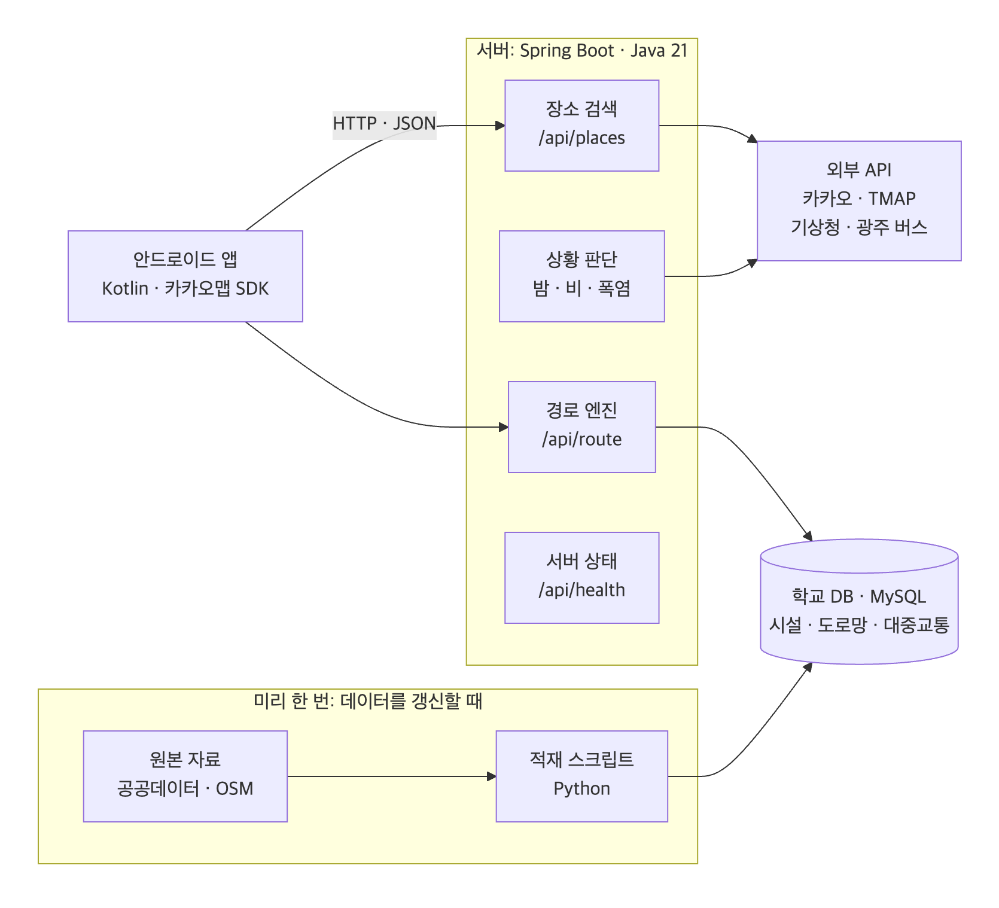

# 세잎지도 문서

세잎지도의 요구사항 분석서와 변경 이력을 두는 저장소다. 코드는 [safe-route](https://github.com/Safe-Way/safe-route)에 있다(2026-10-30에 문서와 코드를 나눔).

| 문서 | 내용 |
|---|---|
| [requirements.md](requirements.md) | 요구사항 분석서 목차 (탭 7개로 나뉜 파일 목록) |
| [requirements/](requirements/) | 요구사항 분석서 본문: 원본 문서의 탭 하나가 파일 하나 |
| [CHANGELOG.md](CHANGELOG.md) | 요구사항 분석서 변경 이력: 무엇이 바뀌었고 왜 바꿨는지 |

원본은 Claude 문서 [세잎지도 요구사항 분석서](https://claude.ai/artifact/FQvgiTtePsoNKVNBhhHdTy)이고,
`requirements/` 폴더의 파일은 원본의 탭을 하나씩 Markdown으로 내보낸 것이다. 이 파일들을 직접 고치지 않는다.

## 시스템 구조

- **무거운 일은 미리 한 번만 한다.** 내려받기·정제·길마다 원값 계산은 적재 스크립트가 데이터를 갱신할 때 해서 DB에 넣어 둔다. 경로를 찾을 때 서버는 DB를 읽어 계산만 한다.
- **앱은 서버하고만 통신한다.** 키가 필요한 외부 API는 서버가 대신 부르므로 앱에는 키가 들어가지 않는다(카카오맵 SDK 키만 예외).

**경로 한 번 찾는 순서**

1. 앱이 출발·도착과 모드(`adult`·`child`·`senior`·`wheelchair`)를 `POST /api/route`로 보낸다.
2. 서버가 일몰 시각으로 밤인지 판단하고, 모드에 맞는 기준을 고른다.
3. 두 점 주변 500m 안의 길(`road_edge`)·길별 원값(`edge_stat`)·시설(`poi`)을 DB에서 읽는다. 도로망은 광주 행정구역 전체라 경로는 광주 안에서만 찾는다(결정 44).
4. 최단 경로와 맞춤 경로를 계산한다. 맞춤 경로는 최단 경로의 1.3배(노인 1.2배) 안에서 고른다.
5. 두 경로가 지나는 시설을 세어 "180m 더 돌지만 CCTV +12대" 같은 설명을 만들어 돌려준다.

부분별 지금 구현 상태, DB 표, API는 요구사항 [7~9장](requirements/07-tech-architecture-api.md)에 있다. 그림 원본은 [requirements/images/architecture.mmd](requirements/images/architecture.mmd)(mermaid)이고, [조직 README](https://github.com/Safe-Way/.github-private/blob/main/profile/README.md)의 구조도와 같은 파일이다. 한쪽을 고치면 다른 쪽도 같이 바꾼다.

## 요구사항을 바꿀 때

1. 원본 문서를 고친다.
2. 바뀐 탭을 Markdown으로 내보내 `requirements/` 안의 해당 파일을 통째로 덮어쓴다. 내보낸 파일의 그림 자리 표시는 `requirements/images/`의 그림 링크로 바꾼다(8장 시스템 구성 → `architecture.png`, 8.2 → `route_core_erd.png`). 탭이 늘거나 이름이 바뀌면 `requirements.md` 목차도 고친다.
3. [CHANGELOG.md](CHANGELOG.md) 표 맨 위에 한 줄 추가: 바뀐 곳, 무엇이, **왜**, 요청한 사람.
4. `feature/docs-…` 브랜치에서 커밋하고 `develop`으로 PR을 연다. PR 본문에도 왜 바꿨는지 적는다.

## 바뀐 내용 보는 법

- **한 번에 바뀐 것:** PR의 Files changed 탭. 문서 파일은 오른쪽 위 문서 아이콘(rich diff)을 누르면 표와 글이 렌더링된 상태로 비교된다.
- **지금까지 바뀐 순서:** `requirements/` 안 각 파일 화면 오른쪽 위 History. 탭으로 나누기 전(v5까지)의 기록은 `requirements.md`의 History에 있다.
- **왜 바뀌었나:** CHANGELOG.md의 "왜" 칸.
