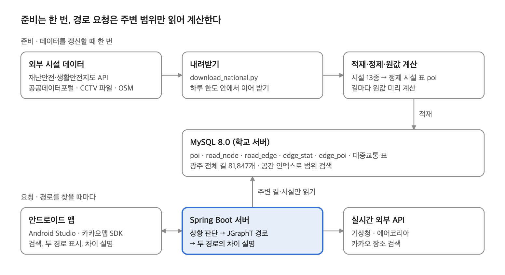
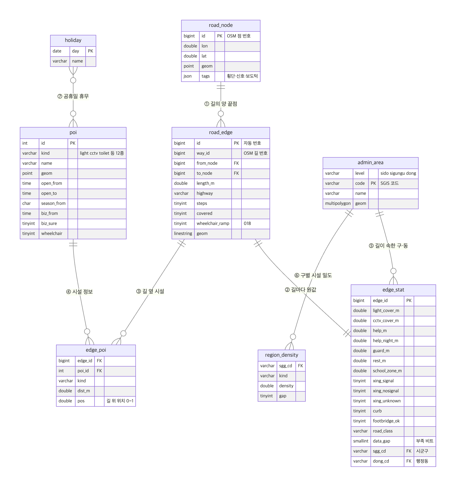

<!-- 원본: https://claude.ai/artifact/FQvgiTtePsoNKVNBhhHdTy 의 "7~9. 기술·구조·API" 탭을 내보낸 것. 이 파일을 직접 고치지 말고 원본을 고친 뒤 다시 내보낸다. -->

## 7. 기술 스택 결정

서버는 **Java 21 + Spring Boot + MySQL**, 길찾기는 **JGraphT**, 앱은 **안드로이드(Android Studio, Kotlin) + 카카오맵 SDK**로 한다. 학교 서버가 MySQL이고 언어는 Java로 정했기 때문에, 그 안에서 직접 고칠 수 있는 것을 골랐다. 처음에는 웹(Leaflet + PWA)을 추천했지만, SOS 경보음·문자·화면이 꺼져도 위치 받기가 필요해 안드로이드 앱으로 정했다(결정 10·30번).

| 영역 | 결정 | 이유 | 검토한 대안 |
| --- | --- | --- | --- |
| 언어 | Java 21 (Temurin) | 사용자 결정 | Python |
| 프레임워크 | Spring Boot 4.1.2 (Web MVC) | 앱이 부르는 REST API를 제공 (8.3) | — |
| 빌드·도구 | Maven(래퍼 포함), IntelliJ | 사용자 결정 | Gradle |
| DB | MySQL 8.0.41 (학교 서버) · 8.4 (로컬 개발용) | 학교 서버가 MySQL 8.0이고 로컬에는 8.4를 깔음. 쓰는 기능(공간 인덱스, JSON 가상 칸)은 두 버전에서 같게 동작. 공간 인덱스와 `ST_Distance_Sphere` 동작 확인 | PostgreSQL + PostGIS (기능은 더 많지만 서버가 없음) |
| DB 접근 | JdbcTemplate | 수백만 건 적재와 공간 SQL을 직접 쓰기 쉬움 | JPA |
| 길찾기 | JGraphT (다익스트라·A\*) | 비용 함수를 마음대로 바꾸고, 경로 위 시설을 세기 쉬움 | GraphHopper (빠르지만 상황별 비용·설명을 붙이기 어려움), pgRouting (PostgreSQL 필요) |
| 전국 길찾기 구조 | 길·감점은 DB에, 요청 때 출발·도착 주변 범위만 읽어 그래프 생성 | 전국 그래프를 메모리에 두지 않아도 됨. 도보는 거리가 짧아 범위가 작음 | 전국 그래프 상주 |
| 도로망 | OpenStreetMap. Overpass API로 광주 행정구역 전체를 칸 30개로 나눠 받아 Python 스크립트로 넣음(2026-11-03, 결정 44. 처음에는 시연 지역 반경 2km). 광주 밖으로 넓힐 때는 대한민국 PBF를 읽을 예정 | 보행길·계단·덮개 정보가 있고 무료 | 국가교통DB 보행네트워크 (지역이 제한적) |
| 공간 계산 | JTS (버퍼, STRtree), 좌표 변환은 공식 직접 구현 | 시설→길 결합을 메모리에서 빠르게 | Proj4J (EPSG:3857·4326만 쓰므로 불필요) |
| 일몰 계산 | commons-suncalc | 위도·경도·날짜만으로 계산, API 호출 없음 | 한국천문연구원 API |
| 화면 | 안드로이드 앱, Android Studio + Kotlin으로 개발 | SOS 경보음·문자·잠금 화면 버튼·화면이 꺼져도 위치 받기는 앱이어야 됨. 팀 결정(결정 10·30번). 앱 언어는 Kotlin(2026-10-30 확정) | Leaflet 웹 + PWA (처음 추천), Capacitor |
| 배경 지도 | 카카오맵 Android SDK (일반·위성) | 국내 지도 품질, 위성 지도 제공, 장소 검색도 카카오 | OpenStreetMap 타일, VWorld |
| 장소 검색 | 카카오 로컬 API (서버가 대신 호출) | 한국 장소 검색 품질, 하루 10만 번 무료 | 네이버 검색 API |
| 데이터 내려받기 | Python 3 표준 라이브러리 스크립트 | 가끔 돌리는 도구라 설치 없이 실행. 시설 적재는 Java, 도로망·행정구역 경계·edge\_stat은 Python이 SQL을 만들어 mysql로 넣음(2026-11-02) | Java로 통일 |
| 테스트 | JUnit 5 + Spring Boot Test | 기본 포함 | — |
| 버전 관리 | git + GitHub 비공개 저장소 3개: 서버 코드는 safe-route, 안드로이드 앱은 safe-route-android(패키지 com.deungbul.anshimgil, Jetpack Compose, minSdk 26), 요구사항 문서는 safe-route-docs (2026-10-30에 나눔) | `.env`·원본 데이터는 제외 | — |

## 8. 시스템 구조

무거운 일(내려받기, 적재, 길마다 감점 계산)은 **데이터를 갱신할 때 한 번**만 하고, 경로 요청 때는 출발·도착 주변의 길과 감점만 읽어 가중치를 곱해 계산한다.



앱은 서버하고만 통신하고, 인증키가 필요한 외부 API는 서버가 대신 부른다. 앱이 부르는 서버 주소는 8.3에 있다.

**지금 구현 상태 (2026-11-03).** 새로 더하거나 합치면 이 표를 고친다.

| 부분 | 하는 일 | 코드 | 지금 상태 |
| --- | --- | --- | --- |
| 앱 | 지도·모드 선택·검색·설정 화면, 서버 호출 | safe-route-android (Kotlin, 카카오맵 SDK) | 화면 만듦. 서버 연결 전이라 예시 데이터로 동작 |
| 서버 | 장소 검색(`/api/places`), TMAP 비교 경로, 상황 판단(밤), 서버 상태(`/api/health`), 공통 오류 처리 | safe-route develop (패키지 place·tmap·situation·health·common) | develop에 합침 |
| 경로 엔진 | `/api/route`: 모드별 낮·밤 기준, 커버율 계산, 시설 이용 가능 판단, 설명 문장 | safe-route develop (패키지 route, 기준값 `route.yml`, `docs/route-weights.md`) | develop에 합침(2026-11-03, PR #28, B파트) |
| 적재 스크립트 | 원본 자료를 받아 정제하고 길별 원값을 미리 계산해 DB에 넣음 | safe-route `scripts/` (Python), ingest 패키지 (Java) | 시설·도로망·`edge_stat`·`poi`·대중교통까지 넣음 |
| 학교 DB | 시설·도로망·길별 원값·대중교통 표 (8.2) | MySQL 8.0.41 (학교 서버) | 시설 약 550만 건, `poi` 100,547곳, 광주 전체 길 81,332개(자동차전용도로 515개 뺀 뒤), 대중교통 표 9개 |

**연결 전에 맞출 것 (2026-11-04).** ① 경로 엔진은 develop에 합쳤다(PR #28·#29·#30). ② 모드 이름은 엔진 기준 `adult`·`child`·`senior`·`wheelchair`로 정했고(결정 43), 앱도 이 이름을 보내도록 바꿨다(safe-route-android PR #20, 2026-11-03). ③ 휠체어 모드에서 경사로가 있는 계단(`road_edge.wheelchair_ramp = 1`)은 빼지 않는다(결정 43, PR #30에 반영). ④ 앱이 부를 길찾기 창구 `POST /api/route`는 C파트 PR #33으로 올라와 있고 아직 develop에 합치지 않았다. ⑤ 학교 DB는 학교 네트워크 안에서만 접속되므로, 시연 때 서버를 어디에 둘지 정해야 한다(0.5, 8.4).

### 8.1 경로 요청 처리 순서

1. 출발·도착 좌표를 받는다 (장소 이름이면 카카오로 좌표를 찾는다).
2. 일몰 계산·기상청·에어코리아로 상황을 판단하고 가중치를 정한다 (1차는 일몰 계산으로 밤만, 비·폭염 등은 2차).
3. 두 점을 감싼 사각 범위를 사방 500m 넓혀 그 안의 길·감점을 DB에서 읽는다.
4. JGraphT로 최단 경로와 상황 경로를 계산한다 (최대 우회 1.3배 규칙 적용).
5. 두 경로가 지나는 시설을 세어 차이 설명을 만든다.
6. 경로 선, 시설 위치, 설명문을 JSON으로 돌려준다.

### 8.2 DB 표 설계

경로 계산에 쓰는 표의 관계다. 실제 DB에는 외래 키가 없고(표를 통째로 지우고 다시 넣는 방식), 선은 칸 값으로 이어지는 논리적 관계다. 표 전체는 아래 표와 코드 저장소 `docs/erd/`에 있다.



선 끝 모양은 개수다. 세로줄 두 개는 "딱 하나", 동그라미와 갈퀴는 "0개 이상"이다(예: 점 하나에 길이 여러 개 이어짐). 선마다 왜 연결되는지는 아래와 같다.

| 선 | 이어지는 칸 | 왜 연결되나 |
| --- | --- | --- |
| ① 길의 양 끝점 | `road_edge.from_node`·`to_node` → `road_node.id` | 길 하나는 두 점을 잇는다. 경로 엔진은 점을 꼭짓점, 길을 선으로 삼아 길찾기 그래프를 만든다 |
| ② 길마다 원값 | `edge_stat.edge_id` → `road_edge.id` (길 하나에 한 줄) | 길마다 밝기·CCTV가 덮는 길이, 도움 시설·쉴 곳·보호구역까지 거리, 횡단·보도턱·육교 같은 원값을 미리 계산해 둔다. 엔진이 길을 고를 때 읽는다(6.1) |
| ③ 길 옆 시설 | `edge_poi.edge_id` → `road_edge.id` | 길마다 50m 안에 있는 시설과 길 위 위치. 경로가 지나는 길로 시설 목록과 "80m 앞 편의점" 같은 안내를 만든다 |
| ④ 시설 정보 | `edge_poi.poi_id` → `poi.id` | `edge_poi`에는 시설 번호만 있어, 이름·종류·여는 시간은 `poi`에서 가져온다 |
| ⑤ 길이 속한 구·동 | `edge_stat.sgg_cd`·`dong_cd` → `admin_area.code` | 길 시작점이 있는 구·동. 그 구의 시설 밀도가 낮으면 그 길의 `data_gap`(데이터 부족) 비트를 켠다 |
| ⑥ 구별 시설 밀도 | `region_density.sgg_cd` → `admin_area.code` | 시군구마다 시설 종류별 밀도를 세어, 전국 중간값의 10% 아래면 부족으로 본다 |
| ⑦ 공휴일 휴무 | 칸으로 잇지 않음 (`poi_status` 뷰가 오늘 날짜로 `holiday`를 봄) | 평일만 여는 시설은 공휴일에 닫힌 것으로 본다 |

학교 DB의 표는 아래 다섯 묶음이다(2026-11-04). 표마다 칸 설명은 코드 저장소 `docs/erd/`(표 32개 ERD 코드)와 학교 DB 데이터 목록 문서에 있다.

| 묶음 | 표 | 무엇 | 건수 |
| --- | --- | --- | --- |
| 경로 계산 (위 그림) | `road_node`·`road_edge` | 길이 만나는 점과 두 점 사이의 길(길이, 도로 종류, 계단, 덮인 길, 휠체어 경사로 `wheelchair_ramp`) | 62,113·81,332 |
|  | `edge_stat` | 길마다 미리 계산한 원값(밝기·CCTV가 덮는 길이, 도움 시설·쉴 곳·보호구역까지 거리, 횡단·보도턱·육교, `data_gap`). 0\~1 감점은 서버가 계산(6장) | 81,332 |
|  | `poi`·`poi_status`(뷰) | 정제 시설(광주, 12종)과 지금 이용 가능한지 | 100,547 |
|  | `edge_poi` | 길마다 50m 안 시설과 길 위 위치 | 171,026 |
|  | `holiday`·`admin_area`·`region_density` | 공휴일, 행정구역 경계, 시군구별 시설 밀도 | 40·365·1,260 |
| 도로망에서 뺀 길 | `road_edge_excluded`·`edge_stat_excluded` | 사람이 걸을 수 없는 자동차전용도로. 엔진은 읽지 않음(결정 46) | 515 |
| 원본 시설 | 시설 표 13개(`streetlight`·`security_light`·`cctv` 등, 5.1)·`facility_all`(뷰)·`facility_unlocated`·`data_source` | 받은 그대로의 시설, 위치를 못 찾은 줄 보관, 출처별 적재 기록. `poi`를 만드는 재료라 엔진은 읽지 않음 | 약 550만·7,162 |
| 대중교통 | `subway_station`·`subway_entrance`·`subway_timetable`·`subway_transfer`·`subway_exit_bus`·`subway_exit_place`·`bus_stop`·`bus_line`·`lowfloor_bus` | 광주 지하철·버스(5.1 19\~24번). FR-37과 휠체어 모드에 씀 | 28,446줄 |
| 아직 없음 | `accident_zone`(보류, FR-44)·`user_place`(추후, FR-45 2단계) | 사고다발 영역, 사용자 제보 장소 | — |

좌표는 WGS84 경도·위도를 `POINT(경도, 위도)`로 넣고(SRID 0) 거리는 `ST_Distance_Sphere`로 잰다. MySQL의 SRID 4326은 위도·경도 순서라 실수하기 쉽기 때문이다.

### 8.3 앱↔서버 API (1차)

1차에서 앱이 부르는 서버 주소는 3개다. SOS·경보음·보호자 문자는 휴대폰 안에서 끝나므로 서버 API가 없다. 걷는 동안의 위치도 서버에 보내지 않는다(NFR-07). 모든 주소는 `/api`로 시작하고 JSON(UTF-8)으로 주고받는다. 좌표는 `lat`(위도)·`lon`(경도)로 이름을 붙여 쓰고, 경로 선(`geometry`)만 GeoJSON 순서인 `[경도, 위도]` 배열이다.

| 주소 | 하는 일 | 관련 FR | 만드는 파트 |
| --- | --- | --- | --- |
| `GET /api/places` | 장소 이름·주소 검색. 서버가 카카오 키워드 검색을 대신 부름 | FR-01 | C |
| `GET /api/places/nearby` | 현재 위치에서 지금 이용 가능한 가장 가까운 화장실·경찰서·지킴이집·쉼터. DB의 poi\_status 뷰에서 꺼냄(카카오 안 부름) | FR-50 | C |
| `POST /api/route` | 출발·도착 → 최단·안전 경로, 차이 설명, 경로 주변 시설 | FR-02\~07 | B(계산), C(주소) |
| `GET /api/health` | 서버·DB 상태와 데이터 기준일. 시연 전 점검용 | — | C |
| POST /api/explain (3차) | 기본 설명 문장을 LLM으로 다듬어 돌려줌. 실패하면 기본 문장 | FR-43 | C |

**장소 검색** `GET /api/places?query=국립아시아문화전당&lat=35.1473&lon=126.9214`

- `query`는 필수(2자 이상). `lat`·`lon`은 선택이고, 주면 가까운 순으로 준다.
- 결과는 최대 10개다.

```json
{ "places": [
  { "name": "국립아시아문화전당", "address": "전남광주통합특별시 동구 문화전당로 38", "lat": 35.1473, "lon": 126.9214, "distanceM": 0 }
] }
```

- 카카오가 실패하면 `503`과 `SEARCH_UNAVAILABLE`을 준다. 앱은 "검색이 잠시 안 됩니다. 지도를 길게 눌러 고를 수 있어요"를 띄운다(4.2).

**가까운 곳** `GET /api/places/nearby?lat=35.1473&lon=126.9214&kind=toilet&mode=senior` (FR-50, 김재휘 안)

- `kind`: `toilet`·`police`·`guard_house`·`school_zone`·`shelter`·`bell` 중 하나(앱이 설정에서 고른 종류마다 부름). `mode=wheelchair`이면 화장실은 장애인 화장실(`poi.wheelchair = 1`)만. `school_zone`·`bell`은 여는 시간이 없어 상태 없이 가까운 순서로 준다.
- 서버는 `poi_status`에서 1km 안, `now_status`가 '이용 가능'인 곳을 직선으로 가까운 5곳까지 돌려준다. 없으면 '확인 안 됨'인 곳을, 그마저 없으면 빈 목록과 가장 가까운 닫힌 곳(`closest_closed`)을 준다.
- 앱은 목록의 곳들로 `/api/route`를 불러 걷는 거리가 가장 짧은 곳을 ③에 보여 준다(처음에는 찫 번째 곳만 불러도 됨).

```json
{ "places": [
    { "id": 51234, "kind": "toilet", "name": "광주역 공중화장실", "lat": 35.1461, "lon": 126.9208, "distanceM": 140,
      "nowStatus": "이용 가능", "nowNote": "개방 시간 06:00~22:00", "wheelchair": true } ],
  "closestClosed": null }
```

**경로 계산** `POST /api/route`

요청:

```json
{
  "origin":      { "lat": 35.1473, "lon": 126.9214, "name": "국립아시아문화전당" },
  "destination": { "lat": 35.1393, "lon": 126.9230, "name": "남광주역" },
  "night": "auto"
}
```

- `night`: `auto`(기본, 일몰 계산), `on`, `off` 중 하나(FR-03). 낮에 시연할 때는 `on`으로 보낸다.
- `mode`: `child`(어린이·청소년)·`senior`(노인)·`wheelchair`(휠체어)·`adult`(기본, 그 밖의 보행자) 중 하나. 1차부터 보낸다. 없으면 `adult`. 모르는 값이면 서버가 오류를 돌려준다.

  모드 이름은 경로 엔진(`route.yml`)의 이름으로 정했다(결정 43, 2026-11-03). 앱(safe-route-android)도 PR #20으로 이 이름을 보낸다: 화면 이름 장애인 → `wheelchair`, 일반 → `adult`, 어린이 → `child`, 노인 → `senior`. 예전 이름(`disabled`·`general`)으로 휴대폰에 저장된 모드도 읽는다.

응답 (좌표와 시설 목록은 줄인 예):

```json
{
  "conditions": { "night": true, "nightSource": "auto", "sunset": "17:41" },
  "routes": [
    { "kind": "shortest", "distanceM": 1150, "durationMin": 15,
      "geometry": [[126.9214, 35.1473], [126.9217, 35.1462]],
      "counts": { "cctv": 8, "light": 41, "bell": 1, "help": 2 } },
    { "kind": "safe", "distanceM": 1330, "durationMin": 17,
      "geometry": [[126.9214, 35.1473], [126.9226, 35.1468]],
      "counts": { "cctv": 20, "light": 71, "bell": 4, "help": 4 } }
  ],
  "explanation": {
    "text": "180m(2분) 더 돌지만 CCTV +12대, 가로등 +30개, 비상벨 +3개",
    "extraM": 180, "extraMin": 2,
    "diff": { "cctv": 12, "light": 30, "bell": 3, "help": 2 }
  },
  "facilities": [
    { "type": "CCTV", "lat": 35.1455, "lon": 126.9220, "on": "safe" }
  ],
  "dataQuality": { "status": "OK", "message": null, "dataDate": "2026-10-28" }
}
```

| 필드 | 뜻 |
| --- | --- |
| `routes[].kind` | `shortest`(지도에 회색) 또는 `safe`(초록). 두 경로가 같으면 `safe` 하나만 오고 설명은 "가장 짧은 길이 가장 안전한 길입니다" |
| `distanceM`, `durationMin` | 거리(m)와 걸리는 시간(분). 시간은 모드별 속도(기본 분당 80m, 어린이 70m, 노인·휠체어 60m)로 계산 |
| `counts` | 경로에서 결합 반경(결정 12번) 안에 있는 시설 수. `light`는 가로등+보안등, `bell`은 비상벨, `help`는 경찰·편의점·아동안전지킴이집 |
| `explanation` | 차이 설명 문장(FR-06)과 그 근거 숫자. 앱은 `text`를 그대로 보여 준다 |
| `facilities[]` | 지도 아이콘용 시설(FR-07). `on`은 `safe`·`shortest`·`both`. 최대 300개. 서버는 경로의 길 id로 edge\_poi를 읽어 만든다. 화장실·쉼터·경찰·비상벨·지킴이집에는 nowStatus(이용 가능·닫힘·운영 기간 아님·확인 안 됨)와 nowNote(근거 문장)를 붙인다(poi\_status 뷰, 결정 40, 김재휘 안) |
| `dataQuality.status` | `OK`, `PARTIAL`(경로 일부가 데이터 없는 곳), `NO_DATA` 중 하나. `OK`가 아니면 앱은 "이 지역은 안전 데이터가 부족합니다"를 띄우고 안전하다고 말하지 않는다(NFR-04) |

오류는 `{ "code": "TOO_FAR", "message": "…" }` 형식으로 준다.

| HTTP | code | 언제 | 앱에 띄우는 말 |
| --- | --- | --- | --- |
| 400 | `SAME_POINT` | 출발과 도착이 50m 안 | "출발과 도착이 너무 가까워요" |
| 400 | `TOO_FAR` | 직선거리 5km 넘음(설정값) | "걸어가기엔 멀어요" (대중교통은 3차, FR-37) |
| 422 | `OUT_OF_AREA` | 도로망을 감싼 사각형 밖 (1차는 광주만. 사각형 안의 나주·담양·화순 일부는 아직 못 막음, 4.1) | "아직 광주만 길찾기가 됩니다" |
| 404 | `NO_ROUTE` | 가장 가까운 길이 300m 넘게 떨어짐, 또는 두 점이 지날 수 있는 길로 이어지지 않음(예: 휠체어가 계단·턱·육교를 빼면 끊김) | "경로를 찾지 못했어요" |
| 503 | `DB_UNAVAILABLE` | DB 연결 실패 | "잠시 후 다시 시도해 주세요" |

오류는 위 표 순서로 검사해 먼저 걸린 하나만 준다. 응답 시간 목표는 직선 3km 안에서 2초다(0.3). 경로 엔진 자체 목표는 요청 하나 1초이고, 문화전당 반경 2km에서 0.6\~1.4초가 걸렸다(2026-11-04, 학교 DB 읽기 포함). 서버 안의 처리 순서는 8.1을 따른다.

**서버 상태** `GET /api/health` → `{ "status": "UP", "db": "UP", "dataDate": "2026-10-28", "roadArea": "광주" }`

**2차에 늘어나는 것.** 응답의 `facilities[]`마다 경로의 몇 m 지점·왼쪽/오른쪽(FR-30)이 붙는다. 다시 안내(FR-35)는 새 주소 없이 같은 `/api/route`를 현재 위치로 다시 부른다. 경로마다 `arriveAt`(도착 예상 시각, FR-01-2)은 1차부터 넣는다. 비·폭염 등 다른 상황의 근거값은 3차다. 앱은 모르는 필드를 무시하므로 필드가 늘어도 깨지지 않는다.

**3차: 설명 다듬기** `POST /api/explain` (FR-43, 3.5). 앱은 `/api/route`의 기본 문장을 먼저 보여 준 뒤 이 주소를 따로 부른다. 요청 본문은 `/api/route` 응답의 `conditions`·`explanation`·`dataQuality`를 그대로 보낸다(좌표와 장소 이름은 빼고). 서버는 상태를 남기지 않고, LLM을 3초까지만 기다린다.

```json
{ "text": "곧 해가 지니까, 120m만 더 걸으면 …", "source": "llm" }
```

`source`는 `llm`(검사를 통과한 다듬은 문장) 또는 `template`(LLM 실패·3초 초과·검사 탈락으로 기본 문장을 그대로 돌려줌)다. 앱은 `llm`일 때만 카드의 문장을 바꾼다. 이 주소가 멈춰도 경로 화면은 기본 문장으로 그대로 동작한다.

### 8.4 앱↔서버 연결에 필요한 것

앱은 서버 주소로 HTTP 요청을 보내고 JSON을 받는다(8.3). 중간에 따로 둘 서버(게이트웨이·메시지 큐 등)는 없다. 대신 아래 다섯 가지를 챙겨야 휴대폰에서 실제로 연결된다.

| 항목 | 할 일 | 파트 |
| --- | --- | --- |
| 휴대폰에서 서버까지 가는 길 | 학교 DB는 학교 네트워크 안에서만 접속되므로, 서버는 학교망에 연결된 노트북에서 돌린다. 개발: 에뮬레이터는 `http://10.0.2.2:8080`(노트북의 localhost), 실제 휴대폰은 노트북과 같은 와이파이에서 `http://노트북IP:8080`. 발표·학교 밖 시연: 노트북 서버를 터널(cloudflared 등)로 https 주소에 열거나 서버·DB를 클라우드로 옮김(0.5 "서버를 어디에") | C, D |
| http 허용 | 안드로이드는 기본으로 https만 허용한다. 앱은 network\_security\_config.xml에서 10.0.2.2·localhost·127.0.0.1만 http를 허용해 두었다. 같은 와이파이의 실제 휴대폰으로 시연하려면 노트북 IP를 여기에 추가한다. 터널(https)을 쓰면 필요 없음 | D |
| 통신 라이브러리 | 앱은 따로 라이브러리 없이 HttpURLConnection과 org.json으로 부른다(data/ServerApi.kt). 요청·응답 모양은 8.3을 따름. 서버 주소는 local.properties의 SERVER\_BASE\_URL에 넣고, 비워 두면 예시 데이터를 쓴다 | D |
| 키 나누기 | 앱에는 카카오맵 SDK용 네이티브 앱 키만 넣고, 카카오 개발자 콘솔에 앱의 키 해시를 등록. 카카오 REST·공공데이터·TMAP·LLM 키는 서버 `.env`에만 두고 앱은 서버를 거쳐 씀(NFR-05) | C, D |
| 실패 처리 | 앱 요청 타임아웃은 연결 5초, 응답 10초. 실패하면 "경로를 불러오지 못했어요"와 다시 시도 버튼(3.4). SOS는 서버 없이 동작 | D |

카카오맵 네이티브 앱 키·키 해시 등록 방법과 앱 설정(`local.properties`)은 13. 부록 B에 있다.

## 9. 외부 API 명세

아래 API는 모두 실제 호출까지 확인했다(TMAP은 2026-10-30, LLM은 아직 정할 것). 카카오 도보 길찾기는 제휴 파트너 전용이라 우리 키로는 403(permission denied)이 나와 TMAP으로 바꿨다. 기상청·에어코리아 한도는 개발계정 기준 대략값이다. 키 값은 `.env`에만 있고, 아래는 `.env`의 키 이름이다.

| API | 주소 | 필수 값 | 한도 | `.env` 키 |
| --- | --- | --- | --- | --- |
| 기상청 초단기실황 | `apis.data.go.kr/1360000/VilageFcstInfoService_2.0/getUltraSrtNcst` | `base_date`, `base_time`(매시 정각, 40분 뒤 제공), `nx`, `ny`, `dataType=JSON` | 개발계정 하루 1만 번 | `DATA_GO_KR_KEY` |
| 기상청 초단기예보 | `…/getUltraSrtFcst` | `base_time`(매시 30분, 45분 뒤 제공), 6시간치 | 같음 | `DATA_GO_KR_KEY` |
| 에어코리아 시도별 실시간 | `apis.data.go.kr/B552584/ArpltnInforInqireSvc/getCtprvnRltmMesureDnsty` | `sidoName`, `ver=1.0`, `returnType=json` | 개발계정 하루 500번 | `DATA_GO_KR_KEY` |
| 재난안전데이터 경찰 | `www.safetydata.go.kr/V2/api/DSSP-IF-00080` | `serviceKey`, `pageNo`, `numOfRows`(최대 1,000), `returnType=json` | 키당 하루 1,000번, 2027-10-28 만료 | `SAFETYDATA_POLICE_KEY` |
| 재난안전데이터 보안등 | `…/DSSP-IF-00083` | 같음 | 같음 | `SAFETYDATA_SECURITYLIGHT_KEY` |
| 재난안전데이터 가로등 | `…/DSSP-IF-00084` | 같음 | 같음 | `SAFETYDATA_STREETLIGHT_KEY` |
| 생활안전지도 데이터 | `www.safemap.go.kr/openapi2/IF_xxxx` | `serviceKey`, `pageNo`, `numOfRows`(최대 1,000), `returnType=JSON` | 하루 1,000번 | `SAFEMAP_KEY` |
| 생활안전지도 그림(WMS) | `www.safemap.go.kr/openapi2/IF_xxxx_WMS` | `srs`, `bbox`, `width`, `height`, `format`, `transparent` | 하루 1,000번 | `SAFEMAP_KEY` |
| 카카오 키워드·주소 검색 | `dapi.kakao.com/v2/local/search/keyword.json` (장소 검색), `.../address.json` (데이터 적재 때 주소 → 좌표: 공중화장실 약 5.4만 번, CCTV 좌표 오류 약 6천 번, 몰린 좌표 약 6천 번, 광주 보안등 약 9천 번, 2026-11-02). 주소로 못 찾으면 키워드 검색에 '시·군 + 이름'(화장실 이름, 비상벨 설치 장소)을 넣고, 결과 주소에 그 시·군이 있을 때만 씀 | 요청 머리글 `Authorization: KakaoAK {키}`, `query` | 하루 10만 번 무료, 넘으면 429 | `KAKAO_REST_KEY` |
| TMAP 보행자 경로 (비교용) | TMAP routes/pedestrian (SK open API) | 출발·도착 좌표 | 하루 1,000건 (무료 상품) | `TMAP_APP_KEY` |
| ODsay LAB 대중교통 길찾기 (FR-37) | `api.odsay.com/v1/api/searchPubTransPathT` (노선 선 좌표는 `loadLane`) | `apiKey`, `SX`·`SY`(출발 경도·위도), `EX`·`EY`(도착 경도·위도) | 한도는 확인 필요. 호출은 확인함(조선대→광주송정역 경로 16개). 서버용 키는 호출하는 서버 IP 등록이 필요할 수 있음 | `ODSAY_API_KEY` |
| 광주 버스 도착 (FR-37) | apis.data.go.kr/6290000/gj\_bis/arriveInfo (정류장 목록은 stationInfo, 노선은 lineInfo) | serviceKey, BUSSTOP\_ID, resultType=json. 응답: LINE\_NAME(노선), REMAIN\_MIN(남은 분), REMAIN\_STOP(남은 정류장), LOW\_BUS(1이면 저상), DIR\_END(방면), ARRIVE\_FLAG | 개발계정 한도라 서버가 정류장마다 잠깐(예: 30초) 저장해 두고 다시 씀(안). 2026-11-03 활용 신청 뒤 호출 확인 | DATA\_GO\_KR\_KEY |
| 광주교통공사 지하철 편의시설 | www.grtc.co.kr/subway/openapi/json/disabledFacilityInformation (역 주소는 stationInformation) | station\_id (1 평동 \~ 20 녹동). 응답: 편의시설 종류(DT\_01 엘리베이터 \~ DT\_09)마다 전체·이용 가능 수, 고장 난 출입구 | 키 없음. http로 부르면 https로 넘어가므로 https로 부름 | — |
| Overpass API (OSM 도로망) | overpass-api.de/api/interpreter (바쁘면 overpass.private.coffee 등 미러) | data = Overpass QL (걸을 수 있는 highway 길, 남·서·북·동 범위) | 키 없음. 공용 서버라 바쁘면 거절됨. 받은 응답은 data/raw/osm/에 남김 | — |
| 공공데이터포털 표준데이터 (보안등·육교·횡단보도) | api.data.go.kr/openapi/tn\_pubr\_public\_scrty\_lmp\_api, …\_overpass\_api, …\_crosswalk\_api | serviceKey, pageNo, numOfRows(1,000), type=json | 개발계정 한도. 어린이보호구역(…\_child\_prtc\_zn\_api)은 아직 오류 30(키 미등록)이라 CSV로 받음 | DATA\_GO\_KR\_KEY (데이터별 키가 있으면 그것을 먼저) |
| LLM 설명 다듬기 (FR-43, 3차) | 정할 것 | 사실 목록(숫자·상황·모드·부족한 데이터 종류)과 기본 문장. 좌표·장소 이름은 보내지 않음 | 정할 것. 3초 안에 답이 없으면 기본 문장. 같은 사실은 저장해 둔 문장을 다시 씀 | 정할 것 (서버 .env에만) |

**TMAP 구간 종류:** 보행자 경로 응답의 구간마다 `facilityType`이 온다(12 육교, 14 지하보도, 15 횡단보도, 17 계단). `searchOption=30`이면 계단을 뺀 경로를 준다. 비교 평가와 장애인 모드 확인에 쓴다.

광주 지하철: 실시간 도착 API는 공개되지 않았다(광주교통공사 stationTimeInfomation은 역 사이 걸리는 시간뿐, 2026-11-03 확인). 다음 열차는 열차 시간표(5.1)로 계산한다. 엘리베이터가 몇 번 출구에 있는지도 공개 자료가 없다.

**기상청 격자:** 위도·경도를 람베르트 원추 투영 공식으로 nx·ny에 바꾼다. 아시아문화전당은 nx=59, ny=74다(조선대는 60, 74).

**실패 처리:** 외부 API는 3초 안에 답이 없으면 포기하고 마지막으로 저장해 둔 값을 쓴다. 저장한 값도 없으면 그 상황은 "정보 없음"으로 둔다(NFR-03).
