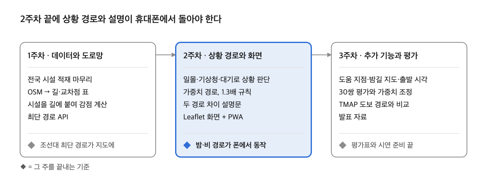

<!-- 원본: https://claude.ai/artifact/FQvgiTtePsoNKVNBhhHdTy 의 "10~12. 평가·일정·결정" 탭을 내보낸 것. 이 파일을 직접 고치지 말고 원본을 고친 뒤 다시 내보낸다. -->

## 10. 평가 방법

국립아시아문화전당 주변(반경 2km) **출발·도착 30쌍**에서 최단 경로, 상황 경로, TMAP 보행자 경로를 같은 지표로 비교한다. 핵심 질문은 "얼마나 더 걸어서 얼마나 더 밝고 안전한 길로 가는가"다.

**비교 기준을 TMAP으로 고른 이유.** 우리 최단 경로는 우리 도로망(OSM)으로 계산하므로, "사람들이 실제로 쓰는 길찾기는 밤에 어떤 길로 보내는가"를 보려면 외부 길찾기가 하나 필요하다. 카카오 도보 API는 제휴 파트너 전용이라 우리 키로는 403이 나왔고, 네이버 지도 API는 자동차 길찾기만 제공한다. TMAP 보행자 경로는 개인 키로 쓸 수 있고 경로 좌표를 돌려주므로, 그 선에 우리 감점을 그대로 매겨 같은 지표로 비교할 수 있다.

**테스트 쌍.** 직선 500m\~3km. 정문·후문·기숙사·남광주역·충장로·주택가 사이를 섞고, 밤·비·폭염 각 상황으로 계산한다. 쌍 목록은 CSV로 고정해 다시 돌려도 같은 결과가 나오게 한다.

| 지표 | 계산 | 목표 (가설) |
| --- | --- | --- |
| 우회율 | 상황 경로 길이 ÷ 최단 경로 길이 | 밤 평균 1.15 이하, 최대 1.3 |
| 조명 밀도 | 경로 30m 안 가로등·보안등 수 ÷ 100m | 최단 경로보다 30% 이상 높음 |
| CCTV 밀도 | 경로 50m 안 카메라 대수 ÷ 100m | 최단 경로보다 높음 |
| 도움 지점 최대 공백 | 경로에서 300m 안에 도움 지점이 없는 가장 긴 구간(m) | 최단 경로보다 짧음 |
| 데이터 부족 비율 | "데이터 부족" 구간 길이 ÷ 전체 길이 | 보고만 함 |
| 계산 시간 | 요청부터 응답까지 | 2초 이내 (NFR-01) |

**민감도.** 가중치를 0.5배·1배·2배로 바꿔 우회율과 조명 밀도가 어떻게 변하는지 그래프로 보인다. 여기서 가중치 초깃값을 확정한다.

**현장 확인.** 30쌍 중 3\~5쌍은 밤에 두 명 이상이 직접 걸어 사진을 남기고, 데이터와 실제가 다른 곳(꺼진 가로등, 없는 CCTV)을 기록한다.

## 11. 일정과 위험

핵심은 **2주차 끝에 상황 경로와 차이 설명이 휴대폰에서 동작**하는 것이다. 가로등은 하루 호출 한도 때문에 3일에 나눠 받고 있어 10월 30일쯤 다 들어온다.

발표 날짜는 아직 정해지지 않아 주 단위로만 적었다.

| 위험 | 영향 | 대응 |
| --- | --- | --- |
| 공공데이터의 지역 편차 (예: 전국 CCTV 파일의 광주 동구 누락) | 시설이 있는데도 점수가 낮게 나옴 | 시연 지역은 지자체 파일로 보충, 나머지는 "데이터 부족" 표시 |
| OSM 보행길 누락·오류 | 실제로 못 가는 길을 추천 | 차도 옆 길도 보행 가능으로 포함, 현장 확인 3\~5쌍 |
| 전국 도로망 적재 용량·시간 | 1주차 지연 | 광주를 먼저 넣고 전국은 여유가 있을 때 |
| 외부 API 장애·한도 초과 | 상황 판단 불가 | 저장해 둔 값 사용, "정보 없음" 표시 (NFR-03) |
| 학교 MySQL 접속 불가 | 발표 환경 문제 | 노트북 로컬 MySQL로 시연 |
| 가중치 근거 부족 | 발표 질문에 답하기 어려움 | 민감도 분석과 현장 확인 결과로 설명 |
| 이용 조건 (공공누리 4유형: 상업적 이용·변경 금지) | 공개·상용화 제한 | 학습 목적으로만 사용, 출처 표시 |
| 채팅에 노출된 인증키 | 다른 사람이 한도를 써 버림 | 키는 .env에만 두고, 채팅 기록을 공유할 때만 재발급 |

## 12. 결정 기록

지금까지 55건을 정했다. 확정 38건, 뒤 결정으로 바뀐 것 7건, 추천안 10건(11\~21번, 팀 확인 필요)이다. 결정마다 한 줄만 적고, 자세한 이유는 괄호 안의 장과 [변경 이력](https://github.com/Safe-Way/safe-route-docs/blob/main/CHANGELOG.md)에 있다. 추천안은 확인한 뒤 상태 칸을 바꾸면 된다.

| # | 결정 | 날짜 | 상태 |
| --- | --- | --- | --- |
| 1 | 언어는 Java | 10-28 | 확정 |
| 2 | 빌드는 Maven, 개발 도구는 IntelliJ | 10-28 | 확정 |
| 3 | 서비스 범위는 전국, 개발·시연은 한 지역에서 (지역은 결정 37) | 10-28 | 확정 |
| 4 | DB는 학교 MySQL, 로컬 DB는 같은 구조로 개발용 | 10-28 | 확정 |
| 5 | 캠퍼스 조명·지역 안심귀갓길·24시간 편의점은 데이터에서 뺀 (어린이보호구역은 결정 35에서 넣음) | 10-28 | 확정 |
| 6 | 휠체어 모드 제외 | 10-28 | 바뀜 → 32 |
| 7 | 공통POI 가로등·보안등·경찰을 하루 1,000번으로 신청 | 10-28 | 확정 |
| 8 | 누가 걷는지에 따라 바뀌는 사용자 모드를 둠 | 10-28 | 바뀜 → 22·38 |
| 9 | 비교용 도보 길찾기는 TMAP 보행자 경로 (도보 API를 여는 곳이 TMAP뿐, 10장) | 10-28 | 확정 |
| 10 | 화면은 안드로이드 앱 + 카카오맵 SDK (7장) | 10-28 | 확정 |
| 11 | 길은 DB에 두고 출발·도착 주변만 읽어 JGraphT로 계산 | 10-28 | 추천 (확인 필요) |
| 12 | 시설 반경을 종류별로 다르게 (지금 값은 6.1) | 10-28 | 추천 (확인 필요) |
| 13 | 범죄주의구간은 화면 그림으로만, 경로에는 쓰지 않음 | 10-28 | 추천 (확인 필요) |
| 14 | 경사(DEM) 제외, 노인은 계단 기준으로 대신 | 10-28 | 바뀜 → 36 |
| 15 | 시연 지역 CCTV·보안등은 지자체 파일로 보충 | 10-28 | 추천 (확인 필요) |
| 16 | 지역은 주소가 아니라 좌표로 고름 | 10-28 | 추천 (확인 필요) |
| 17 | 상황 기준: 폭염 33℃, 한파 영하 10℃, 미세먼지 나쁨 (날씨는 보류, 6.4) | 10-28 | 추천 (확인 필요) |
| 18 | 최대 우회는 최단의 1.3배, 노인 1.2배 (6.2) | 10-28 | 추천 (확인 필요) |
| 19 | 생활안전지도 치안시설은 받지 않음 (공통POI 경찰과 같음) | 10-28 | 추천 (확인 필요) |
| 20 | 내려받기·적재는 Python 스크립트 (7장) | 10-28 | 추천 (확인 필요) |
| 21 | 모드별 기준·우회 한도·보행 속도 초깃값 (6.2) | 10-28 | 추천 (확인 필요) |
| 22 | 모드를 나이대로 나누고 성별 전용 모드는 두지 않음 | 10-29 | 바뀜 → 35·38 |
| 23 | 112 자동 신고는 하지 않음. SOS는 경보음 + 보호자 문자, 112는 직접 거는 버튼 (3.2) | 10-29 | 확정 |
| 24 | 길을 벗어나면 먼저 다시 안내하고, 그래도 돌아오지 않을 때만 이탈 알림 (FR-35) | 10-29 | 확정 |
| 25 | 넘어짐 감지는 노인 모드에서만 (FR-33) | 10-29 | 확정 |
| 26 | 걷기+대중교통은 ODsay 결과를 쓰고 걷는 구간만 우리 경로 (FR-37) | 10-29 | 확정 |
| 27 | 사고·공사로 막힌 길의 실시간 반영은 하지 않음 (공개 API 없음, 1장) | 10-29 | 확정 |
| 28 | LLM 쓰임은 세부 분석 때 정함 | 10-29 | 바뀜 → 31 |
| 29 | 범위를 1·2·3차·발표용으로 나눔 | 10-29 | 바뀜 → 33 |
| 30 | 앱은 Android Studio + Kotlin, 서버는 IntelliJ | 10-29 | 확정 |
| 31 | LLM은 설명 문장을 다듬는 데만 씁. 서버가 검사하고 실패·3초면 기본 문장 (FR-43, 3차) | 10-30 | 확정 |
| 32 | 휠체어(장애인) 모드를 넣음. 계단·못 지나는 육교·확인된 턱·비포장은 빼고 우회 한도 1.2배 (FR-46, 6.2, 비포장·한도는 11-04 B파트) | 10-30 | 확정 |
| 33 | 목적을 '걷는 사람에게 맞는 길 안내와 이유 설명'으로 정하고 1·2·3차를 다시 나눔. 새 아이디어는 추가안으로만 (0.4) | 10-30 | 확정 |
| 34 | 대상은 어린이·노인·장애인과 그 가족, 주기능 3개 (0장) | 10-30 | 확정 |
| 35 | 처음 켜면 모드 4개(어린이·노인·장애인·일반) 중 하나를 고르고, 지도에 모드별 시설을 먼저 보여 줌 (FR-38·39·48) | 10-30 | 확정 |
| 36 | 경사 데이터는 모든 모드에서 쓰지 않고, 급경사는 길 상태 신고로 받음 (FR-49, 6.4) | 11-02 | 확정 |
| 37 | 개발·시연·평가 지역을 국립아시아문화전당 반경 2km로 옮김 (조선대에서) | 11-02 | 확정 |
| 38 | 안심 강화(FR-21)를 빼고 모드는 4개만 둠 | 11-02 | 확정 |
| 39 | 데이터 정제 기준: 방범용이 아닌 CCTV 뺀, 몰린 좌표 다시 찍기, 못 찾은 줄은 보관 (5.1) | 11-02 | 확정 |
| 40 | 시설마다 지금 이용할 수 있는지 표시 (`poi_status`, 6.3) | 11-02 | 확정 |
| 41 | 가까운 곳 바로 가기(FR-50)를 1차에 넣음 | 11-03 | 확정 |
| 42 | 광주 대중교통 자료를 받아 둔다. 버스 도착은 요청 때 API로 부름 (5.1, 8.2) | 11-03 | 확정 |
| 43 | 모드 이름은 `adult`·`child`·`senior`·`wheelchair`로 통일, 경사로 있는 계단은 휠체어에서 빼지 않음 (8.3) | 11-03 | 확정 |
| 44 | 도로망을 광주 전체로 넓힘. 경로는 광주 안에서만 (4.1) | 11-03 | 확정 |
| 45 | 횡단보도 신호·보도턱 현장 조사는 하지 않고, 모르는 횡단은 "확인 안 됨" | 11-03 | 확정 |
| 46 | 자동차전용도로(`motorroad`·`expressway`)를 도로망에서 빼고 따로 보관 (8.2) | 11-04 | 확정 |
| 47 | 설정의 "지도에 보일 시설" 체크박스로 모드 기본 외 시설도 켜고 끔(예: 일반 모드에 쉼터). 지하철역을 노인·장애인 지도에 더함 (FR-48) | 11-04 | 확정 |
| 48 | 길찾기 결과를 걸어서 가기·대중교통 탭으로 나누고, 대중교통 경로(FR-37)와 정류장 저상버스 도착(FR-51, 없으면 일반 버스)을 2차에 넣음 | 11-04 | 확정 |
| 49 | 불편 접수(사진 신고, FR-49)를 추가안에서 2차로 올림 | 11-04 | 확정 |
| 50 | 서버는 학교 서버에 도커로 띄움. develop에 머지하면 테스트 뒤 자동 배포(앱 서버 2대 한 대씩 교체), 주소는 https://safe-route.java21.net, main은 중요한 기능이 완성될 때만 올림 (7장, 8.4) | 11-05 | 결정 55로 바뀜 |
| 51 | 지하철역·출입구는 모든 모드 지도에 공통으로 보임. 노인·장애인 모드는 역에 "엘리베이터 출구 N곳" 배지와 엘리베이터가 확인된 출입구 강조(나머지는 확인 안 됨). 역의 휠체어 판단은 출구 기준이라, 장애인 모드는 지상에서 엘리베이터로 못 들어가는 역(양동시장·녹동)을 회색으로. 출입구 92곳 중 엘리베이터 있음 46·없음 46(광주교통공사 엘리베이터 현황·역정보, 문화전당 3·4·5번은 현장 확인) (FR-48, 8.3) | 11-05 | 확정 |
| 52 | 날씨·미세먼지는 따로 부르지 않고 길찾기 결과(POST /api/route)에 같이 넣어 앱에 보냄. 경로 비용에는 아직 쓰지 않음 (8.3, 6.4) | 11-05 | 확정 |
| 53 | 버스 도착 정보는 내 주변 정류장들과 곧 오는 버스(남은 분·정류장 수·저상 여부)를 한꺼번에 보여 줌. 앱은 내 위치(위도·경도)를 보내고, 같은 창구로 정류장 하나만도 볼 수 있음. 반경·정류장 수와 주소 이름은 서버 구현 뒤 맞춤 (FR-51, 8.3) | 11-05 | 확정 |
| 54 | 개인화는 휴대폰의 게스트 번호로 하고 위치 기록은 서버에 두지 않음. ① 걸음 속도: 길안내 때 재서 DB(`walk_profile`)에 속도 숫자만 저장하고, 쓰는 속도 = (모드 기본 속도×5 + 측정 합) ÷ (5 + 측정 수)로 모드 기준에서 내 속도로 서서히 옮김(FR-52) ② 출발 알림: 지하철은 시간표로 "몇 시에 나가면 몇 분 열차"까지 보여 주고, 버스는 30분 안에 오는 버스 중 걸어서 닿는 것만 띄움(FR-10·37) ③ 자주 가는 곳 패턴은 요일·시간대별 횟수를 세는 규칙으로 제안(학습 모델·LLM 안 씀, FR-39-1·47) | 11-05 | 확정 |
| 55 | 배포는 main에 머지될 때만 함(테스트 통과 뒤 학교 서버 자동 배포, 서버는 하나). develop은 새 기능 브랜치를 따고 합치는 곳이라 테스트만 돎. 흐름: 기능 브랜치 → develop(PR) → develop → main(PR 머지) → 배포. 기능 PR을 main으로 바로 보내지 않음. main으로 오는 PR이 develop에서 온 게 아니면 CI 검사 'main은 develop에서만'이 막음(PR #78) (결정 50을 바꿈, 7장·8.4, safe-route PR #63·#64) | 11-05 | 확정 |

### 열린 질문

- [ ] 추천안 11\~21번을 팀원과 논의해 확정
- [ ] 동구 보안등 파일의 이용 조건 확인 (CCTV 두 파일은 공공데이터포털에서 '이용허락범위 제한 없음' 확인)
- [ ] (선택) 채팅 기록이나 화면을 남과 공유하게 되면 키 재발급
- [ ] LLM 모델과 서버 `.env` 키 이름 정하기 (FR-43)
- [ ] 1차(MVP) 범위를 팀 회의(월요일)에서 확인하고 B·C·D 담당자 정하기
- [ ] 넓혀 다시 찾는 경로(1.5km)의 응답 시간 기준 정하기 (B파트, 6.3·FR-04)
